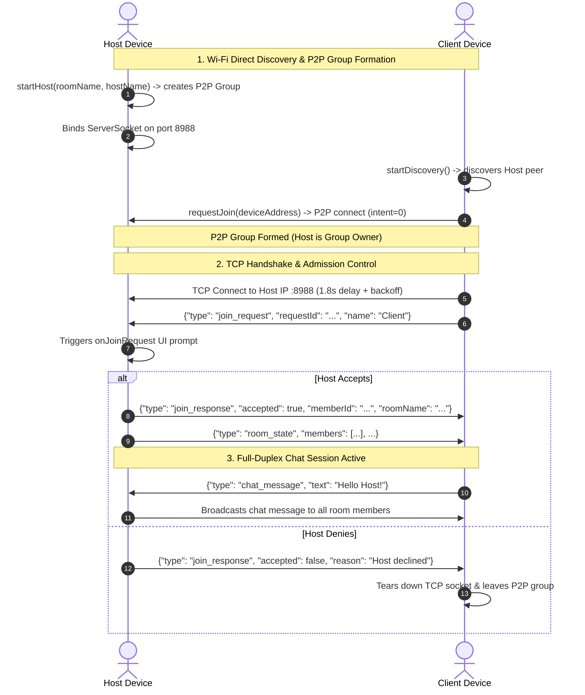

# 📶 Android Wi-Fi Direct (P2P) + TCP Socket POC

[](https://www.android.com/)
[](https://expo.dev/)
[](https://reactnative.dev/)
[](https://kotlinlang.org/)
[](https://www.typescriptlang.org/)
[](LICENSE)

A complete **Expo (React Native) Android POC** and custom native module (`expo-wifi-direct`) delivering **zero-infrastructure, peer-to-peer (P2P) device discovery, Wi-Fi Direct group formation, TCP admission control, and real-time offline local communication** without requiring an external router, Wi-Fi hotspot, or cellular connection.

---

## 📋 Table of Contents

- [Overview](#-overview)
- [Key Features](#-key-features)
- [Architecture](#-architecture)
  - [Two-Layer Model](#two-layer-model)
  - [End-to-End Sequence Flow](#end-to-end-sequence-flow)
- [Wire Protocol Specification](#-wire-protocol-specification)
- [Screens & User Experience](#-screens--user-experience)
- [Native Module Reference (`expo-wifi-direct`)](#-native-module-reference-expo-wifi-direct)
  - [TypeScript API](#typescript-api)
  - [Events Subscribed](#events-subscribed)
- [Prerequisites](#-prerequisites)
- [Quick Start](#-quick-start)
- [Building a Release APK](#-building-a-release-apk)
- [Troubleshooting & Common Issues](#-troubleshooting--common-issues)
  - [1. Java 24 vs Gradle 8.9 ("Unsupported class file major version 68")](#1-java-24-vs-gradle-89-unsupported-class-file-major-version-68)
  - [2. Wi-Fi Direct Permissions & Location Services](#2-wi-fi-direct-permissions--location-services)
  - [3. OEM Timing & P2P Busy (Error Code 2)](#3-oem-timing--p2p-busy-error-code-2)
  - [4. Windows "Destination Path Too Long" (MAX_PATH)](#4-windows-destination-path-too-long-max_path)
- [Project Structure](#-project-structure)
- [Contributing](#-contributing)
- [License](#-license)

---

## 💡 Overview

Standard mobile networking depends on an external access point or cloud server. In scenarios requiring **field operations, offline local multiplayer, emergency coordination, or air-gapped device synchronization**, devices must communicate directly.

While Android provides the `WifiP2pManager` (Wi-Fi Direct) framework, raw usage often suffers from severe real-world challenges:
- **OEM Timing Sensitivity:** Race conditions between group creation and network interface readiness.
- **Transient "P2P Busy" (Error Code 2):** Stale groups left by killed apps block subsequent connections.
- **Accidental Role Flipping:** Clients accidentally negotiating as Group Owner (GO) instead of the Host.
- **Socket Readiness Races:** TCP clients attempting socket connections before the Group Owner IP and routing tables are established by the OS DHCP daemon.

This POC addresses these challenges by encapsulating low-level Android P2P logic in a robust Expo native module with **automated cleanup, retry backoffs, intent guards, and resilient TCP handshake flows**.

---

## ✨ Key Features

- 🌐 **Zero Infrastructure Required:** Operates strictly device-to-device using Wi-Fi Direct (P2P); no cellular data, internet, or router needed.
- 🛡️ **Host Admission Control:** Clients initiate a `join_request` with display name; Hosts receive an instant interactive modal to **Accept** or **Deny** access.
- 👥 **Dynamic Room State Synchronization:** All connected group members automatically receive updated membership lists whenever a client joins or leaves.
- 💬 **Real-Time Local Chat:** Low-latency, full-duplex messaging over TCP sockets broadcasted to all admitted peers.
- 🔄 **Self-Healing Connection Lifecycle:**
  - **Auto-Cleanup on Initialization:** Stale groups from previous app crashes or sessions are cleared on launch (`removeGroup`).
  - **P2P Busy Backoff:** Automated 2.5s retry if the Android Wi-Fi stack reports transient `P2P_BUSY`.
  - **Strict GO Intent:** Clients explicitly declare `groupOwnerIntent = 0` (API 29+) to ensure the Host remains the Group Owner.
  - **TCP Reconnect Backoff:** Client socket attempts up to 5 retries with staggered backoff to accommodate Android P2P IP assignment latency.
  - **Graceful Disconnect:** Sockets and P2P groups are cleanly torn down upon exit without requiring device reboot or app restarts.

---

## 🏗️ Architecture

### Two-Layer Model

```
┌─────────────────────────────────────────────────────────────┐
│                    Application Layer (UI)                   │
│          HomeScreen  │  HostScreen  │  JoinScreen           │
└──────────────────────────────┬──────────────────────────────┘
                               │
┌──────────────────────────────▼──────────────────────────────┐
│        expo-wifi-direct (Native Module & TS Bridge)         │
│  - Event Emission (onRoomState, onJoinRequest, onChat, ...) │
│  - Lifecycle & Guard Management (IDLE | HOST | CLIENT)     │
└──────────────┬──────────────────────────────┬───────────────┘
               │                              │
┌──────────────▼──────────────┐┌──────────────▼───────────────┐
│     Wi-Fi Direct (P2P)      ││       TCP Socket Layer       │
│ - Peer Discovery            ││ - Host: ServerSocket(:8988)  │
│ - Group Owner Formation     ││ - Client: Socket(GO_IP, 8988)│
│ - Connection Info (GO IP)   ││ - Line-delimited JSON Wire   │
└─────────────────────────────┘└──────────────────────────────┘
```

| Layer | Responsibility | Mechanism |
|---|---|---|
| **P2P Layer** | Forms direct physical/link-layer Wi-Fi mesh between devices | `WifiP2pManager.createGroup` (Host) & `connect(config)` (Client) |
| **TCP Layer** | Application messaging, admission control, state sync, and chat | `ServerSocket(8988)` on Host & `Socket(groupOwnerAddress, 8988)` on Client |

### End-to-End Sequence Flow



---

## 📡 Wire Protocol Specification

Communication occurs over raw TCP sockets using UTF-8 **Newline-Delimited JSON** (`LineSocket`). Each line corresponds to an atomic protocol payload:

### 1. `join_request` (Client ➔ Host)
Sent immediately after TCP connection is established:
```json
{
  "type": "join_request",
  "requestId": "req_1719230000000_1234",
  "name": "Pixel 7 User"
}
```

### 2. `join_response` (Host ➔ Client)
Sent when the Host approves or rejects the admission request:
```json
{
  "type": "join_response",
  "accepted": true,
  "requestId": "req_1719230000000_1234",
  "memberId": "mem_1719230005000_5678",
  "roomName": "Conference Room A",
  "hostName": "Alice"
}
```

### 3. `room_state` (Host ➔ All Clients)
Broadcast whenever a participant joins, leaves, or room metadata updates:
```json
{
  "type": "room_state",
  "roomName": "Conference Room A",
  "hostName": "Alice",
  "members": [
    { "memberId": "host_id", "name": "Alice", "isHost": true },
    { "memberId": "mem_1719230005000_5678", "name": "Pixel 7 User", "isHost": false }
  ]
}
```

### 4. `chat_message` (Bidirectional)
Broadcasted to all connected members:
```json
{
  "type": "chat_message",
  "id": "msg_1719230010000_9012",
  "fromMemberId": "mem_1719230005000_5678",
  "fromName": "Pixel 7 User",
  "text": "Hey everyone, offline chat is working!",
  "ts": 1719230010000
}
```

---

## 📱 Screens & User Experience

| Screen | File | Highlights |
|---|---|---|
| **Home** | [`src/screens/HomeScreen.tsx`](src/screens/HomeScreen.tsx) | Live Wi-Fi Direct state monitor, permission validation, Host vs Join entry points. |
| **Host** | [`src/screens/HostScreen.tsx`](src/screens/HostScreen.tsx) | Room name configuration, P2P Group Owner initialization, Admission Request modal, Live Chatroom. |
| **Join** | [`src/screens/JoinScreen.tsx`](src/screens/JoinScreen.tsx) | Real-time P2P peer scanning, one-tap Connect, admission status pending screen, Live Chatroom. |

---

## 🔌 Native Module Reference (`expo-wifi-direct`)

### TypeScript API

Defined in [`modules/expo-wifi-direct/src/ExpoWifiDirectModule.ts`](modules/expo-wifi-direct/src/ExpoWifiDirectModule.ts):

| Method | Signature | Description |
|---|---|---|
| `initialize()` | `(): Promise<void>` | Initializes `WifiP2pManager`, registers receivers, and clears stale groups. |
| `startDiscovery()` | `(): Promise<void>` | Starts peer discovery (`discoverPeers`). |
| `stopDiscovery()` | `(): Promise<void>` | Stops ongoing peer discovery. |
| `startHost(roomName, hostName)` | `(roomName: string, hostName: string): Promise<void>` | Tears down previous group, creates P2P group as GO, binds TCP server. |
| `stopHost()` | `(): Promise<void>` | Shuts down TCP server, closes client sockets, and removes P2P group. |
| `requestJoin(deviceAddress, displayName)` | `(deviceAddress: string, displayName: string): Promise<void>` | Connects to peer P2P group and triggers asynchronous TCP socket connect. |
| `leaveRoom()` | `(): Promise<void>` | Closes client socket, disconnects from P2P group, and resets to `IDLE`. |
| `respondToJoinRequest(requestId, accepted)` | `(requestId: string, accepted: boolean): Promise<void>` | Sends admission response to client and broadcasts updated room state. |
| `sendChatMessage(text)` | `(text: string): Promise<void>` | Transmits a chat message across the active socket connection. |

### Events Subscribed

| Event | Payload Type | When Triggered |
|---|---|---|
| `onP2pStateChanged` | `{ enabled: boolean }` | Wi-Fi Direct hardware state toggled on/off. |
| `onPeersUpdated` | `{ peers: Peer[] }` | List of nearby discovered Wi-Fi Direct devices changed. |
| `onConnectionInfo` | `ConnectionInfo` | P2P group established; reports Group Owner status & IP. |
| `onJoinRequest` | `JoinRequest` | Client has connected via TCP and submitted an admission request. |
| `onJoinResponse` | `JoinResponse` | Host accepted or rejected client admission. |
| `onRoomState` | `RoomState` | Room metadata or participant list changed. |
| `onChatMessage` | `ChatMessage` | Inbound chat message received. |
| `onDisconnected` | `{ reason?: string }` | Socket or Wi-Fi Direct link lost. |
| `onError` | `{ scope: string; message: string }` | Native runtime error encountered. |

---

## 🛠️ Prerequisites

1. **Operating System:** Windows, macOS, or Linux.
2. **Node.js:** v18.x or v20.x LTS.
3. **Java Development Kit (JDK):** **JDK 17** (e.g. [Eclipse Temurin 17](https://adoptium.net/temurin/releases/?version=17) or Android Studio bundled `jbr`).
   > ⚠️ **Do not use Java 24** with Gradle 8.9 (see [Troubleshooting](#1-java-24-vs-gradle-89-unsupported-class-file-major-version-68)).
4. **Android Studio:** Android SDK Tools, Build Tools 34.0.0+, Android NDK.
5. **Physical Devices:** **2 physical Android devices** (Android 10+ / API 29+).
   > ℹ️ *Wi-Fi Direct cannot be tested across Android emulators because emulators share the host network stack and lack P2P Wi-Fi radio virtualization.*

---

## 🚀 Quick Start

### 1. Clone the repository

```bash
git clone https://github.com/your-username/android-wifip2p-feb-26.git
cd android-wifip2p-feb-26
```

### 2. Install dependencies

```bash
npm install
```

### 3. Generate Android Native project (Prebuild)

If the `android/` folder is fresh or needs regeneration:

```bash
npx expo prebuild --platform android
```

### 4. Connect device & run

1. Enable **Developer Options** and **USB Debugging** on your Android device.
2. Turn **ON** Wi-Fi and **Location Services** on the device.
3. Connect the phone via USB and run:

```bash
npm run android
# or
npx expo run:android
```

---

## 📦 Building a Release APK

To create a standalone release APK for testing across multiple physical devices without a development server:

```bash
cd android
.\gradlew.bat assembleRelease   # On Windows
# or: ./gradlew assembleRelease # On macOS/Linux
```

The compiled release APK will be located at:
```text
android/app/build/outputs/apk/release/app-release.apk
```

Install directly via ADB:
```bash
adb install android/app/build/outputs/apk/release/app-release.apk
```

---

## 🔍 Troubleshooting & Common Issues

### 1. Java 24 vs Gradle 8.9 ("Unsupported class file major version 68")

- **Cause:** Gradle 8.9 does not yet support Java 24.
- **Fix:** Set your `JAVA_HOME` environment variable to **JDK 17**:
  - Windows: Point `JAVA_HOME` to `C:\Program Files\Eclipse Adoptium\jdk-17.x` or Android Studio's bundled JBR `C:\Program Files\Android\Android Studio\jbr`.
  - Run `npm run android:gradle-stop` to kill any running Gradle daemons on older Java versions.
  - See detailed guide: [`docs/FIX-JAVA-GRADLE.md`](docs/FIX-JAVA-GRADLE.md).

### 2. Wi-Fi Direct Permissions & Location Services

- **Android 13+ (API 33+):** Requires `NEARBY_WIFI_DEVICES` with `neverForLocation` flag.
- **Android 10-12:** Requires `ACCESS_FINE_LOCATION`.
- **System Location Toggle:** On Android, Wi-Fi Direct peer discovery will return 0 devices if the **system Location toggle is disabled in Quick Settings**, even if runtime permissions are granted. Ensure Location is switched **ON**.

### 3. OEM Timing & P2P Busy (Error Code 2)

- Different manufacturers (Samsung, Xiaomi, Google Pixel) handle Wi-Fi Direct handshakes at varying speeds.
- If a connection fails with "P2P busy", wait 3 seconds and tap Connect again. The built-in module automatically triggers `removeGroup` before retrying.

### 4. Windows "Destination Path Too Long" (MAX_PATH)

Windows restricts paths to 260 characters by default. If cloning or building into a deep directory:
- Run in PowerShell as Administrator:
  ```powershell
  New-ItemProperty -Path "HKLM:\SYSTEM\CurrentControlSet\Control\FileSystem" -Name "LongPathsEnabled" -Value 1 -PropertyType DWORD -Force
  ```
- Alternatively, clone into a shorter directory path (e.g. `C:\pocs\wifi-direct`).

---

## 📂 Project Structure

```text
android-wifip2p-feb-26/
├── App.tsx                          # Main UI container & event subscription router
├── app.json                         # Expo configuration (permissions, plugins, package)
├── package.json                     # JS dependencies & scripts
├── tsconfig.json                    # TypeScript compiler options
├── metro.config.js                  # Metro bundler configuration
├── LICENSE                          # MIT License
├── README.md                        # Project documentation
├── RUN_AND_BUILD.md                 # Step-by-step build notes
├── assets/                          # Application icons and splash screen assets
├── docs/
│   ├── FIX-JAVA-GRADLE.md           # JDK 17 vs Gradle 8.9 setup guide
│   └── WIFI_DIRECT_TECHNICAL_REPORT.md # In-depth technical architecture report
├── src/
│   ├── permissions.ts               # Android Wi-Fi & Location runtime permission flow
│   ├── theme.ts                     # UI palette, styling constants, tokens
│   └── screens/
│       ├── HomeScreen.tsx           # Initial dashboard (Host or Join selection)
│       ├── HostScreen.tsx           # Room creation, admission approval, host chat
│       └── JoinScreen.tsx           # Peer discovery, connection trigger, client chat
└── modules/
    └── expo-wifi-direct/            # Custom Expo Native Module
        ├── expo-module.config.json  # Expo module registration definition
        ├── package.json             # Module manifest
        ├── src/
        │   ├── ExpoWifiDirectModule.ts # TypeScript bridge & event signatures
        │   └── index.ts             # Module exports
        └── android/
            ├── build.gradle         # Android module gradle dependencies
            └── src/main/java/expo/modules/wifidirect/
                └── ExpoWifiDirectModule.kt # Native Kotlin Wi-Fi Direct & TCP implementation
```

---

## 🤝 Contributing

Contributions, issues, and feature requests are welcome!

1. Fork the Project
2. Create your Feature Branch (`git checkout -b feature/AmazingFeature`)
3. Commit your Changes (`git commit -m 'feat: add AmazingFeature'`)
4. Push to the Branch (`git push origin feature/AmazingFeature`)
5. Open a Pull Request

---

## 📄 License

This project is licensed under the [MIT License](LICENSE).
